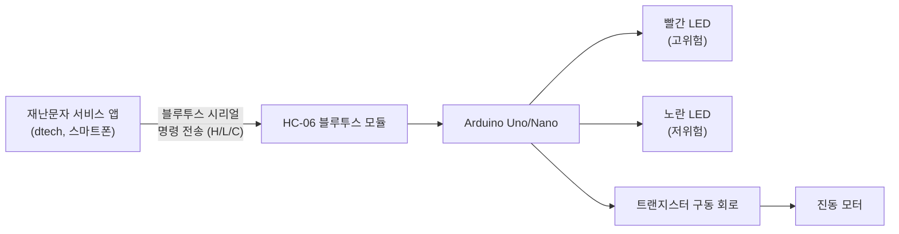
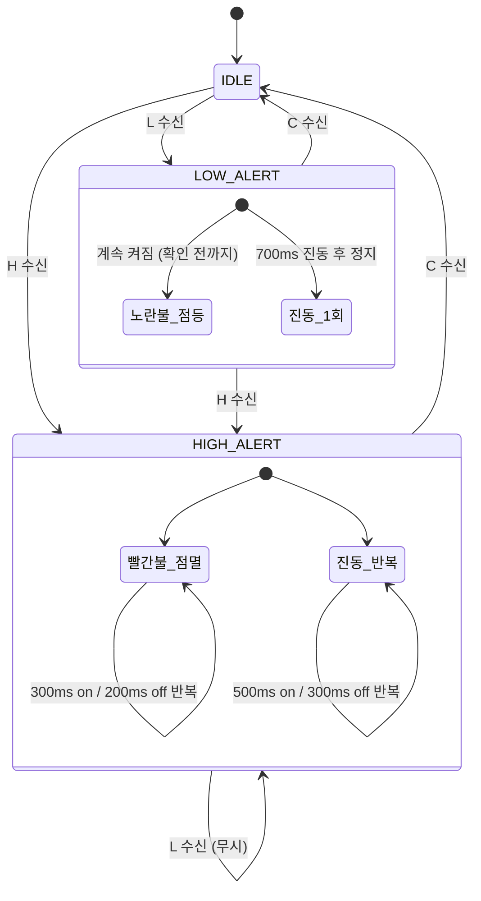

# 발달장애인 재난문자 알림 연동 기기 설계안

**프로젝트**: dtech 발달장애인 재난문자 서비스 연동 웨어러블/거치형 알림기
**목적**: 스마트폰 앱에서 수신한 재난문자 등급을 시각(LED)·촉각(진동) 신호로 변환하여, 문자 읽기가 어려운 발달장애인 사용자가 위험 등급을 즉각적·직관적으로 인지하도록 보조
**제출처**: 사회공헌 플러스

---

## 1. 설계 개요

한국의 재난문자(CBS) 체계는 실제로는 **위급재난문자 / 긴급재난문자 / 안전안내문자** 3단계이지만, 발달장애인 사용자가 즉시 반응해야 하는 정보는 결국 "지금 당장 대피·행동해야 하는가"로 단순화할 수 있습니다. 따라서 본 기기는 앱이 판단한 등급을 **2단계(고위험 / 저위험)** 로 매핑해 반응합니다.

| 앱에서의 등급 | 예시 | 기기 반응 |
|---|---|---|
| **최고 등급** (위급재난문자 등, 즉시 대피 필요) | 공습경보, 대형 화재·화학사고 등 | **빨간 LED 반복 점멸** + **진동 반복** — 앱을 확인하기 전까지 계속 |
| **하위 등급** (긴급재난문자·안전안내문자 통합) | 호우주의보, 실종경보 등 일반 안내 | **다른 색 LED(노랑) 점등** + **진동 1회** — 불빛은 앱 확인 전까지 유지, 진동은 1회만 |
| **앱 확인(읽음)** | 사용자가 알림을 열람/확인 | LED·진동 즉시 정지 → 대기 상태 복귀 |

색상은 빨강/노랑으로 최대한 대비를 크게 하고, 흔히 색각이상에서 혼동되는 빨강/초록 조합은 피했습니다. 또한 발달장애인 사용자의 감각 과민을 고려해 진동은 강한 지속형이 아니라 짧은 on/off 패턴으로 설계했습니다(아래 6장 참고).

---

## 2. 시스템 구성도

앱은 재난문자를 수신하면 등급을 판정해 블루투스로 1글자 명령을 보내고, 사용자가 알림을 확인하면 별도의 정지 명령을 보냅니다. 아두이노는 이 명령만으로 전체 동작을 제어하므로 기기 자체에는 판단 로직이 없고, "표시기" 역할만 합니다(고장 시 피해 최소화, 회로 단순화).

---

## 3. 부품 목록 (BOM)

| 부품 | 규격 | 수량 | 비고 |
|---|---|---|---|
| Arduino Uno (또는 Nano) | - | 1 | 가장 흔하고 자료 많아 초보자용 제작·시연에 적합 |
| HC-06 블루투스 모듈 (Bluetooth Classic, SPP) | - | 1 | 스마트폰(Android)과 시리얼 통신. iOS 연동이 꼭 필요하면 HM-10(BLE) 또는 ESP32로 대체 |
| LED (빨강) | 5mm, 3V | 1 | 고위험 표시 |
| LED (노랑) | 5mm, 3V | 1 | 저위험 표시 |
| 저항 | 220~330Ω | 2 | LED 전류 제한용 |
| 저항 | 1kΩ | 1 | 트랜지스터 베이스 전류 제한용 |
| NPN 트랜지스터 | 2N2222 또는 동급 | 1 | 진동모터 구동(아두이노 핀 직결 시 과전류 위험 방지) |
| 다이오드 | 1N4001~4007 | 1 | 모터 역기전력 보호(플라이백 다이오드) |
| 진동 모터 | 3V 코인/평판형 진동모터 | 1 | 촉각 알림 |
| 저항 | 10kΩ | 1 | HC-06 RX 전압분배용 |
| 브레드보드, 점퍼선 | - | 다수 | - |
| 전원 (9V 배터리+스냅 or USB 케이블) | - | 1 | 휴대형 시연 시 배터리 권장 |

> 참고: HC-06의 RX 핀은 3.3V 로직입니다. 아두이노(5V) TX를 바로 연결하면 손상 위험이 있으므로, 저항 분배(예: 1kΩ+2kΩ 또는 표에 적은 10kΩ+20kΩ 조합) 또는 로직레벨 컨버터를 반드시 사용하세요.

---

## 4. 회로 연결 (핀맵)

| 아두이노 핀 | 연결 대상 |
|---|---|
| D2 (SoftwareSerial RX) | HC-06 TX |
| D3 (SoftwareSerial TX) → 전압분배 후 | HC-06 RX |
| D9 | 빨간 LED (+저항) → GND |
| D10 | 노란 LED (+저항) → GND |
| D6 | 트랜지스터 베이스 (+1kΩ 저항) |
| 5V | 트랜지스터 컬렉터 쪽 진동모터 (+) |
| GND | 트랜지스터 이미터, HC-06 GND, LED 캐소드 공통 |

하드웨어 Serial(D0/D1, USB)은 업로드·디버깅용으로 남겨두고, 블루투스는 `SoftwareSerial`로 별도 처리합니다.

---

## 5. 통신 프로토콜 (앱 → 아두이노)

앱은 블루투스 시리얼로 개행문자(`\n`)로 끝나는 1글자 명령을 전송합니다.

| 명령 | 의미 |
|---|---|
| `H\n` | 최고 등급 알림 발생 (빨간불 반복 점멸 + 진동 반복 시작) |
| `L\n` | 하위 등급 알림 발생 (노란불 점등 + 진동 1회) |
| `C\n` | 확인(Clear) — 사용자가 앱에서 알림을 확인함 (LED·진동 즉시 정지) |

**우선순위 규칙**: 고위험(`H`) 알림이 진행 중일 때 `L`이 들어오면 무시합니다(이미 더 급한 상황이므로 하향 전환하지 않음). 저위험(`L`) 진행 중 `H`가 들어오면 즉시 고위험 상태로 전환합니다. `C`는 어떤 상태에서도 즉시 대기 상태로 복귀시킵니다.

앱 쪽 구현(Android 기준) 개요:
1. `BluetoothSocket`으로 HC-06과 페어링/연결 (SPP UUID: `00001101-0000-1000-8000-00805F9B34FB`)
2. 재난문자 수신 시 등급 판정 → `outputStream.write("H\n".getBytes())` 또는 `"L\n"`
3. 사용자가 알림 화면을 열람/확인하는 순간(예: 알림 클릭, 알림 화면 진입, 혹은 "확인" 버튼) → `outputStream.write("C\n".getBytes())`

---

## 6. 동작 상태 머신

감각 자극을 과하게 주지 않기 위해 진동은 강한 연속 진동이 아니라 짧게 끊어지는 패턴을 사용했고, 저위험 알림의 진동은 1회로 제한해 최고 등급과 확실히 구분되도록 했습니다. 값(300/200/500/300/700ms)은 시연 후 사용자 피드백에 따라 쉽게 조정 가능하도록 코드 상단 상수로 분리했습니다.

---

## 7. 아두이노 펌웨어

`disaster_alert_device.ino` 파일 참고. `delay()` 대신 `millis()` 기반 논블로킹 방식으로 작성하여, 알림이 울리는 도중에도 블루투스로 들어오는 `C`(확인) 명령을 즉시 수신·반영할 수 있도록 했습니다(이 부분이 빠지면 점멸/진동 중 확인 신호를 놓칠 수 있습니다).

---

## 8. UX·안전 고려사항

- **색상 대비**: 빨강/노랑 조합으로 색각이상 사용자도 구분 가능하도록 함(빨강/초록 조합 지양).
- **진동 강도**: 발달장애인 사용자 중 감각 민감도가 높은 경우가 있어, 처음에는 약한 진동모터(3V 코인형)로 시작하고 필요 시 세기를 조절할 수 있게 설계.
- **오작동 대비**: 블루투스 연결이 끊기면 기존 상태를 유지한 채 정지 명령을 받지 못할 수 있으므로, 추후 버전에서는 기기 자체에 물리적 확인 버튼을 추가해 앱 없이도 알림을 끌 수 있게 하는 것을 권장(현재는 앱에서만 해제).
- **저전력 대기**: 대기 상태에서는 LED·모터 모두 꺼져 있어 배터리 소모가 거의 없음.

## 9. 향후 확장 아이디어

- 기기 자체에 확인 버튼 추가(앱 미작동 시 대비)
- BLE(HM-10) 또는 ESP32로 전환해 iOS 지원 및 Wi-Fi 원격 트리거 지원
- 등급별 소리(부저) 옵션 추가(청각 활용 가능한 사용자 대상)
- 여러 대의 기기를 그룹으로 묶어 보호자 기기에도 동시 알림
